:linkcss:
:stylesdir: .
:stylesheet: style.css
:stem: latexmath
include::document_attribute.adoc[]

:toc: left
:toclevels: 4
:toc-title: Mục lục

= Cơ bản về nhiếp ảnh thiên văn

Xin chào! Bài viết này sẽ giới thiệu cho các bạn những kiến thức cơ bản về bộ môn nhiếp ảnh thiên văn, chủ yếu là lý thuyết. Phần thực hành sẽ được tiếp tục khi có điều kiện.

== 1. Giới thiệu

Với những ai yêu thích bầu trời, việc ngắm nhìn những thiên thể trong đêm tối quả thực là một cảm giác kỳ lạ. Sự bí ẩn và bao la của bầu trời đêm luôn kích thích trí tò mò, và đôi khi là cả sự mơ mộng. Nhưng, chỉ nhìn bằng mắt thường thì chưa đủ. Bởi qua quá trình tiến hóa, con người là loài động vật sống về ban ngày. Do đó đôi mắt người, mặc dầu đã phát triển thuộc hàng tốp đầu của thế giới động vật. Nhưng đối mặt với bầu trời đêm, nó lại tỏ ra hạn chế về độ nhạy cũng như màu sắc. Những ai đã từng trải nghiệm kính thiên văn sẽ rõ, nhưng thiên thể rực rỡ đầy màu sắc mà NASA chụp, khi qua mắt thường chỉ là những đám mây mờ nhạt, trắng nhờ. Nhưng, hạn chế đó hoàn toàn có thể khắc phục được với bộ môn nhiếp ảnh thiên văn. Các kỹ thuật khác nhau đã được ứng dụng để tái hiện lại những vật thể mờ nhạt đó thành nhưng hình ảnh rực rỡ, hoàn toàn vượt qua giới hạn sinh học của đôi mắt.

Một số thể loại nhỏ trong nhiếp ảnh thiên văn có thể kể đến:

* **Chụp ảnh Ngân Hà (Milky Way):** Sử dụng ống kính góc rộng để thu được khoảng trời rộng lớn chứa dải Ngân Hà và cả mặt đất làm tiền cảnh.
* **Chụp ảnh mặt trời, mặt trăng, hành tinh:** Chụp qua kính thiên văn có độ phóng đại cao để thấy được các hành tinh nhỏ ở rất xa. Với Mặt trời, cần thêm các kính lọc chuyên biệt.
* **Chụp ảnh vật thể sâu:** Đó là các thiên hà, tinh vân ở khoảng cách rất xa và rất mờ. Một số trong đó có kích thước trên bầu trời (kích thước biểu kiến) rất lớn, nhưng cũng có nhiều vật thể ở rất xa. Độ phóng đại của kính thiên văn và ống kính rất đa dạng.

Hãy cùng xem một số hình ảnh của cộng đồng nhiếp ảnh dưới đây:

.Dải Ngân Hà tại đỉnh Tà Chì Nhù, Yên Bái. Ảnh sử dụng máy ảnh và ống kính góc rộng thông thường, không cần thiết bị hỗ trợ khác ngoài cái tripod. Tác giả: Tui
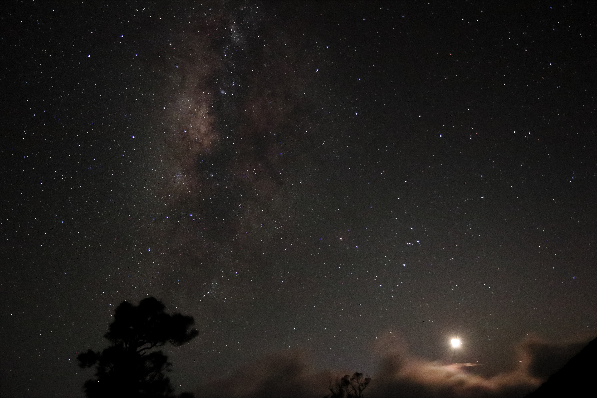

.Tinh vân Dumbell (M27). Dùng các kỹ thuật và thiết bị phức tạp hơn như chân đế bám nhật động, kính lọc phổ hẹp. - Tác giả: Hoàng Long
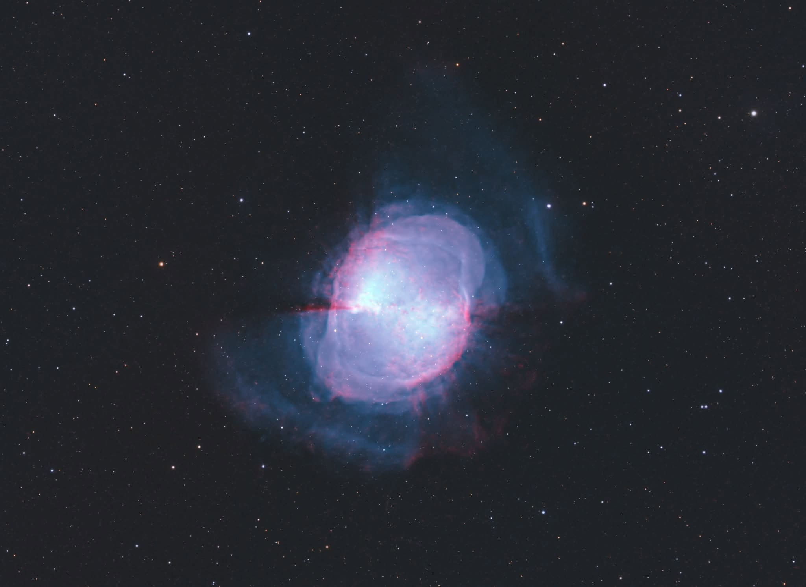

== 2. Vấn đề của nhiếp ảnh thiên văn

Không giống như nhiếp ảnh thông thường, nhiếp ảnh thiên văn được thực hiện với những đối tượng rất tối, đôi khi nằm ngoài phạm vi mà mắt người có thể nhìn thấy, chẵng hạn như ánh sáng hồng ngoại. Việc sử dụng các thiết bị chụp ảnh cũng như các kỹ thuật chụp ảnh thông thường không thể đem lại chất lượng tốt hoặc thậm chí vật thể cũng không xuất hiện được trên hình.

Dưới đây là một ví dụ tương tác mô phỏng cách một máy ảnh thông thường chụp ảnh với đối tượng thiên văn. Bạn hãy thử điều chỉnh các thông số nhiếp ảnh để làm cho hình ảnh xuất hiện.

++++
<iframe src="photo_simulator/photo_sim.html" style="width: 100%; height: 100vh; border: none; margin: 0; padding: 0;"></iframe>
++++

Bạn nhận thấy cảnh đêm rất tối. Áp dụng nguyên tắc, để tăng độ sáng thì cần mở khẩu độ lớn, ISO cao, thời gian phơi sáng lâu. Hãy thử với thông số sau: ISO 6400, phơi sáng 1s, khẩu độ F2.8.

Kết quả:

.ISO 6400, phơi sáng 1s, F2.8
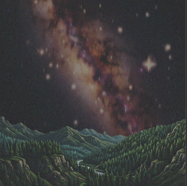

Ảnh lên đã sáng rồi đó, tuy nhiên bạn nhận thấy ảnh khá nhiễu. Đó là do ISO quá cao. Hãy thử giảm ISO xuống và tăng thời gian phơi sáng lên để bù lại (khẩu độ đã mở tối đa). Thử lại với thông số: ISO 1600, phơi sáng 5s, F2.8

Kết quả:

.ISO 6400, phơi sáng 1s, F2.8
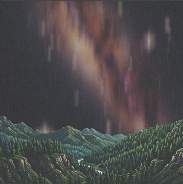

Ảnh đỡ nhiễu hơn chút đỉnh, nhưng mà bầu trời và các ngôi sao lại bị kéo thành vệt dài, trông không còn ra hình dạng ban đầu nữa. Vậy rõ ràng tăng độ sáng bằng cách tăng ISO hay tăng thời gian phơi sáng đều không mang lại kết quả mà ta mong đợi.

Vậy chỉ còn cách cuối cùng: Tăng khẩu độ ống kính để tăng lượng ánh sáng thu được. Bạn tìm thử những ống kính khẩu độ lớn và chợt thấy ví mình hơi đau đau. Nhưng tại sao ống kính khẩu độ lớn lại đắt tiền như vậy? Chẳng phải là chỉ cần sản xuất đường kính của các thấu kính to lên thôi hay sao?

Chúng ta sẽ cùng tìm hiểu những vấn đề trên trong các phần tiếp theo.

---

== 3. Khẩu độ và hiện tượng quang sai ống kính

Bạn nghĩ rằng ống kính muốn thu sáng tốt hơn chỉ cần tăng đường kính (khẩu độ) của nó lên là được đúng không? Đúng. Nhưng tại sao các ống kính khẩu độ lớn lại có giá cực kỳ đắt đỏ?

Các thấu kính với mặt cầu thông thường đều xảy ra hiện tượng méo ảnh ở rìa. Nguyên nhân là vì các tia sáng hội tụ không đúng vào điểm mà ta mong muốn. Cụ thể hơn, với các thấu kính giá rẻ, chúng thường được mài theo hình mặt cầu. Hình dạng này không tối ưu để hội tụ ánh sáng. Càng về rìa thấu kính, mức độ sai lệch càng nặng. Đây gọi là hiện tượng quang sai hình học.

Cách khắc phục, mài bề mặt thấu kính thành các hình dạng phi cầu tối ưu hơn như parabol, hyperbol. Tuy nhiên, để chế tạo các thấu kính này đòi hỏi các máy mài rất phức tạp và đắt tiền. Do đó làm tăng chi phí sản xuất và giá thành.

.Ảnh trên: Thấu kính hội tụ lý tưởng, các tia sáng song song phải hội tụ về một điểm. Ảnh dưới, thấu kính cầu thực tế, các tia sáng càng về rìa càng lệch nhiều hơn (ảnh: Wikipedia)
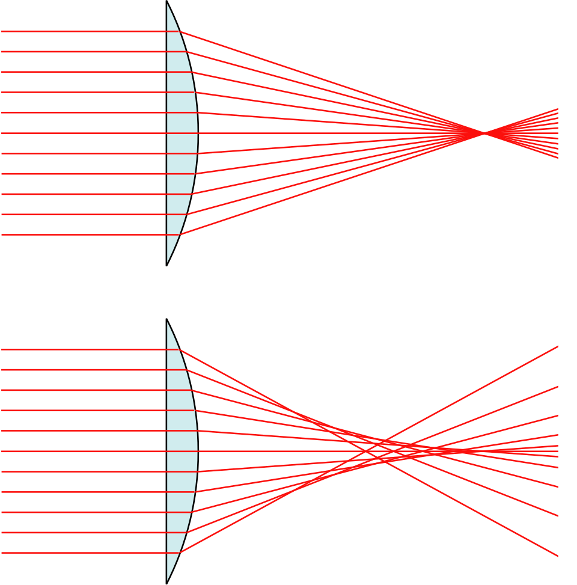

Ngoài ra ánh sáng còn có một đặc điểm, đó là góc khúc xạ khi đi qua thấu kính sẽ khác nhau đối với những bước sóng khác nhau. Do vậy, khi ở rìa thấu kính, ta còn thấy các tia sáng của các màu sắc bị tách ra thành một dải như cầu vồng. Đó gọi là hiện tượng sắc sai, hay quang sai màu.

.Hiện tượng quang sai hình học làm méo ảnh ở rìa, hiện tượng quang sai màu làm ảnh bị kéo thành nhiều màu. (Ảnh: Kính Hải Triều)
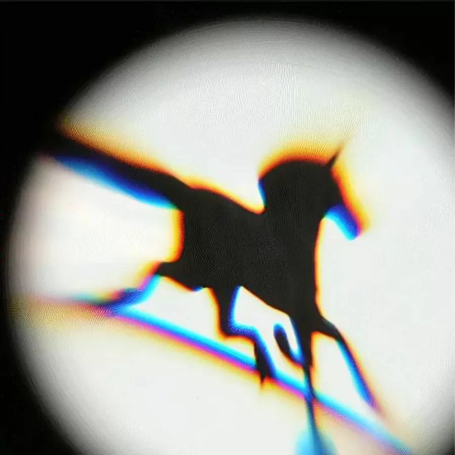

Cách khắc phục là đặt thêm các thấu kính khác phía sau để ánh sáng khúc xạ ngược lại, bù trừ cho sắc sai ban đầu. Và để tránh quang sai hình học, đương nhiên các thấu kính này cũng được chế tạo phi cầu, làm chi phí lại tăng lên gấp bội.

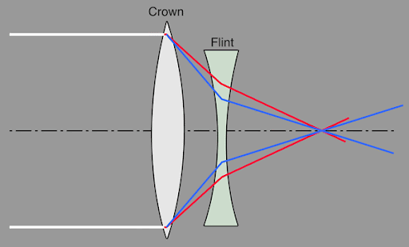

Như vậy, qua phần trên bạn đã hiểu được rằng tăng lượng ánh sáng thu vào ống kính bằng cách tăng khẩu độ (đường kính) của thấu kính là điều khó khăn về mặt kinh tế cũng như kỹ thuật sản xuất. Rõ ràng với dân nhiếp ảnh phổ thông, việc tận dụng những ống kính sẵn có trong chụp ảnh đời thường vào nhiếp ảnh thiên văn là hết sức quan trọng.

Những phần tiếp theo, ta sẽ cùng đi tìm các giải pháp còn lại để khắc phục điều này.

== 4. Tăng thời gian phơi sáng bằng chân đế bám nhật động

Trong thí nghiệm mô phỏng ở phần đầu, bạn cũng có thể thấy khi thời gian phơi sáng dài, hình ảnh sẽ bị kéo thành vệt do bầu trời luôn dịch chuyển không ngừng. Nhưng nếu... chúng ta làm cho camera di chuyển theo thì sao? Liệu có thể nào xoay camera cho tốc độ trùng với tốc độ bầu trời, ảnh tạo ra sẽ trông đứng yên.

Chính xác. Đây là một kỹ thuật không thể thiếu trong nhiếp ảnh thiên văn, đặc biệt với các đối tượng cần độ phóng đại lớn, sự kéo vệt càng trở nên rõ nét. Những thiết bị như vậy được gọi là star tracker mount, hay bộ bám nhật động gắn lên chân đế. Chúng có thể được dùng với cả máy ảnh và kính thiên văn.

Trên thị trường hiện nay có rất nhiều sản phẩm bộ bám nhật động, nhưng để phân loại, ta có thể chia thành các kiểu trục sau:

* Chân đế góc phương vị (AZ - Alt-Azimuth)
* Chân đế xích đạo (EQ - Equatorial)
* Chân đế lai, có thể sử dụng được ở cả 2 chế độ AZ và EQ.

=== 4.1. Chân đế AZ

Kiểu chân này cho phép quay theo 2 trục: 

* Trục góc altitude là trục nằm ngang so với mặt đất, giúp camera xoay nâng lên và hạ xuống.
* Trục phương vị azimuth thẳng đứng vuông góc với mặt đất, giúp camera xoay vòng 360 độ theo phương ngang.

Hình minh họa dưới đây được tạo bởi AI cũng khá chính xác giúp bạn hình dung ra 2 trục này.

.Minh họa AI chân đế kiểu AZ.
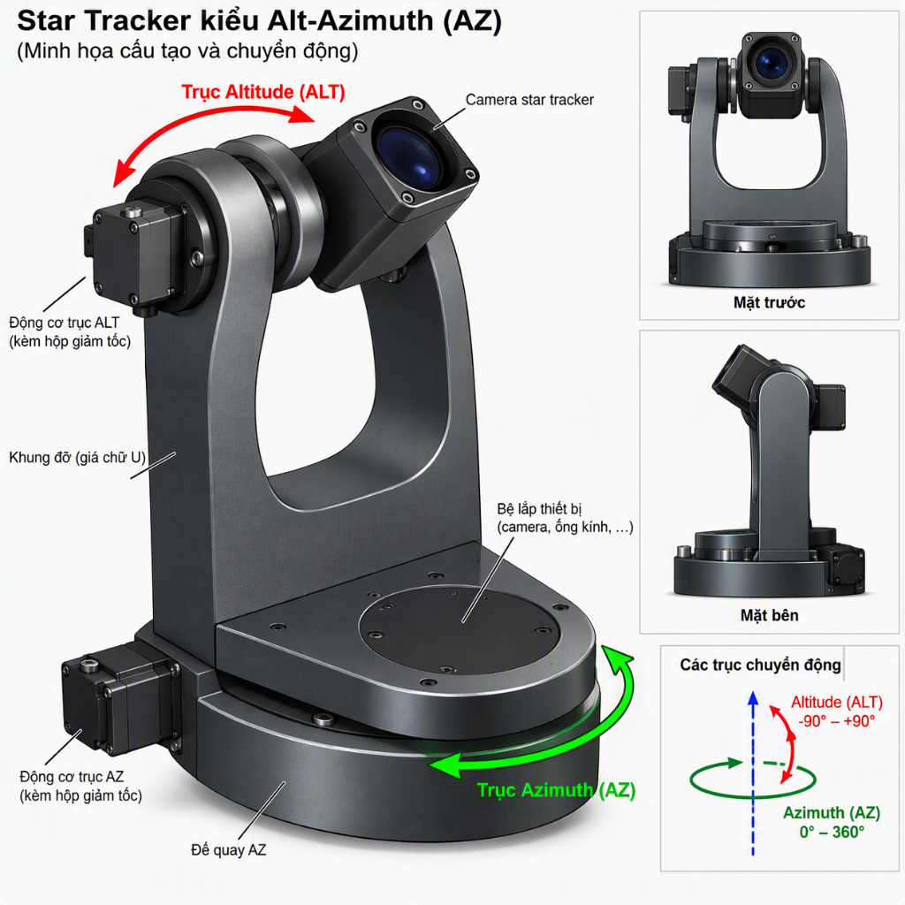

Chân đế dạng này đơn giản, được sử dụng kèm với phần mềm cho phép tự động điều chỉnh tốc độ xoay của 2 trục cho khớp với bầu trời tại tọa độ bạn đang đứng. Nhược điểm, vì sử dụng phối hợp 2 trục quay khác hướng với trục quay bầu trời, nên nó chỉ có thể bám theo được tốc độ và vị trí của vật thể đang quan sát. Trường nhìn của camera vẫn bị xoay so với vật thể đó, gọi là hiện tượng xoay trường ảnh (Field Rotation)

.Hiện tượng trường ảnh xoay khi dùng chân AZ phơi sáng lâu. Ảnh: www.cloudynights.com
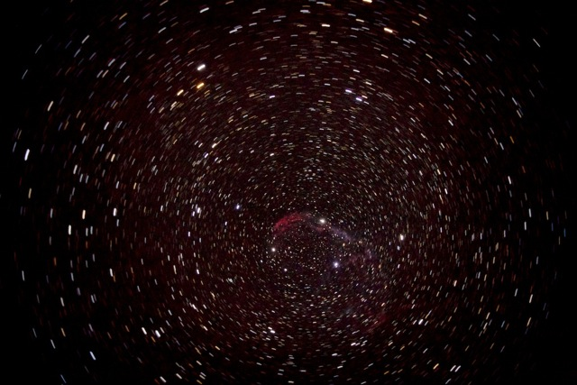

Để khắc phục, người ta sẽ gắn thêm một thiết bị để quay cảm biến camera theo hướng ngược lại, giúp bù trừ chính xác hiện tượng này, gọi là Thiết bị khử xoay trường ảnh (Field Derotator). Hoặc đơn giản hơn có thể giảm thời gian phơi sáng đi, sao cho không cảm nhận được hình ảnh bị xoay. Nhưng đổi lại, lượng ánh sáng thu được cũng bị giảm.

Loại chân đế này phù hợp với quan sát bằng mắt, chụp những vật thể sáng như Mặt Trăng, các hành tinh, chỉ cần bám theo vị trí của chúng và thời gian phơi sáng ngắn. Để khắc phục cho phép thời gian phơi sáng lâu hơn, ta sử dụng loại chân đế thứ 2: Chân đế EQ.

=== 4.2. Chân đế EQ

Loại chân đế này chỉ cần tối thiểu 1 động cơ xoay được điều chỉnh hướng trục song song với trục quay Trái Đất. Khi hoạt động, nó sẽ luôn luôn chuyển động quay trùng với bầu trời. Hiện tượng xoay trường ảnh bị triệt tiêu hoàn toàn.

Nhưng trước khi sử dụng chân đế này để chụp ảnh, ta cần phải căn chỉnh nó sao cho trục quay song song với trục quay Trái Đất. Phương pháp phổ biến nhất là dùng căn chỉnh Sao Bắc Cực. Ngôi sao này có thể quan sát được bằng mắt thường và nằm rất gần điểm cực bắc của bầu trời. Người ta gắn một ống nhòm song song với trục quay của chân EQ và ngắm nó vào Sao Bắc Cực. Lúc này chân đế sẽ quay chính xác theo bầu trời. Đối với những vùng ở nam bán cầu, không thể thấy Sao Bắc Cực, người ta dùng những ngôi sao khác như Sigma Octantis, hoặc ước chừng vị trí tương đối từ những chòm sao lân cận. Tuy nhiên, Sigma Octantis khá mờ và lại khó tìm.

Việc căn chỉnh thủ công như trên rất khó khăn và kém chính xác. Do vậy các chân đế EQ hiện đại hơn sử dụng nhiều trục quay tự động hơn (2 đến 3 trục) và bộ tìm kiếm sao (Goto) kết hợp với bộ dẫn đường (Guider) cho phép tự động tính toán góc căn chỉnh cực và hiệu chỉnh sai số liên tục bằng một camera phụ quan sát một ngôi sao làm chuẩn. Và đương nhiên, các thiết bị này cũng sẽ rất đắt tiền, phù hợp với các kính thiên văn độ phóng đại lớn, nơi mà chỉ cần một sai lệch cực nhỏ cũng có thể phá hỏng cả tấm hình. Với máy ảnh dùng lens tiêu cự khoảng 200mm trở lại, ta chỉ cần một thiết bị star tracker 1 trục và căn chỉnh thủ công cẩn thận là được.

.Minh họa bằng AI kiểu chân đế EQ.
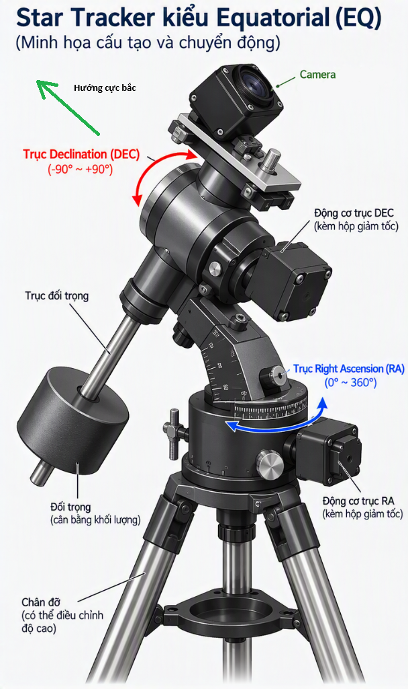

Hình minh họa bằng AI bên trên cho ta một hình dung về chân đế EQ. Dạng chân đế này do cấu tạo không cân bằng và để phù hợp với nhiều loại camera và kính thiên văn, người ta dùng thêm những quả tạ đối trọng giúp giảm mô men xoắn lên động cơ. Do vậy, một nhược điểm khác là chân đế này khá nặng nề và cồng kềnh.

=== 4.3. Chân đế lai

Vốn là dạng chân đế AZ nhưng nó có thể gắn thêm bộ phận nâng hình nêm để một trục quay hướng về cực bắc và quay theo bầu trời như chân đế EQ. Các phần mềm hỗ trợ đi kèm cũng có thể chuyển đổi giữa 2 chế độ này.

.Chân đế AZ của Celestron gắn thêm bộ nêm để trở thành chân đế EQ.
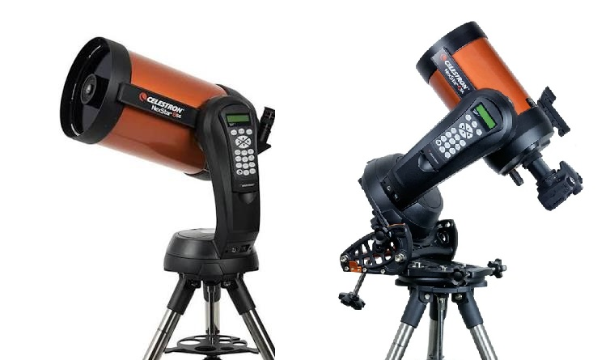

== 5. Xử lý nhiễu ảnh

Ở phần vừa rồi, ta đã có cách để tăng thời gian phơi sáng mà không làm ảnh bị kéo vệt. Câu hỏi đặt ra là: Liệu ta có thể set ISO thật thấp để hạn chế tối đa nhiễu và tăng thời gian phơi sáng lên thật lâu, lên tới vài chục phút một lần chụp? Như vậy liệu có thể không còn quan tâm đến vấn đề nhiễu ảnh không?

Về lý thuyết có vẻ có lý. Nhưng trên thực tế, ta thường sẽ rất khó căn chỉnh cực bắc của chân bám nhật động một cách chính xác tuyệt đối. Do vậy mà thời gian phơi sáng đủ để không bị kéo vệt sẽ hạn chế. Thứ 2 trong quá trình chụp, rất nhiều sự cố có thể xảy ra tác động lên bức ảnh như gió mạnh làm rung máy, vệ tinh, máy bay vô tình lọt vào khung hình. Việc chụp một tấm phơi sáng lâu khi xảy ra sự cố có thể phải bị loại bỏ hoàn toàn.

Từ những lý do này, người ta sẽ phải chụp những tấm ảnh ngắn và sử dụng kỹ thuật xếp chồng ảnh nhằm khử nhiễu. Ta sẽ cùng tìm hiểu về kỹ thuật này.

=== 5.1. Các loại nhiễu trên ảnh chụp

Để hiểu được phương pháp khử nhiễu ảnh, trước tiên ta cần phải hiểu nhiễu là gì, và nguồn gốc của nó từ đâu ra. Từ đó tìm được biện pháp thích hợp để ngăn chặn hoặc loại bỏ chúng.

Nhiễu ảnh là hiện tượng các điểm ảnh khi chụp bị biến đổi một cách ngẫu nhiên so với tín hiệu thu được từ ánh sáng ban đầu. Làm cho hình ảnh xuất hiện những hạt lấm tấm với màu sắc khác nhau. Nguyên nhân của nhiễu ảnh được chia làm các loại sau:

* Nhiễu lượng tử ánh sáng (Photon Shot Noise): Do bản chất lượng tử ánh sáng là ngẫu nhiên, nên tín hiệu mà cảm biến thu được cũng ngẫu nhiên không đồng đều. Đặc biệt hiện tượng này xảy ra với các nguồn sáng yếu. Đây là bản chất tự nhiên không thể phòng tránh, ngoài việc chụp những đối tượng sáng hơn.
* Nhiễu dòng tối, hay Nhiễu nhiệt (Dark Current Noise): Do nhiệt độ của cảm biến tăng dần trong quá trình chụp làm thay đổi điện trở, hoặc electron nhiệt tạo thành một tín hiệu điện giả ngay cả khi không có ánh sáng kích thích. Khi nhiệt độ của pixel đạt đến một ngưỡng nhất định, pixel đó sẽ tạo ra một điểm sáng bất thường, gọi là hot pixel. Nhiễu nhiệt được tích tụ theo thời gian phơi sáng, làm cho bức ảnh như có một lớp "sương" mờ.
* Nhiễu đọc (Read Noise): Gây ra do sai số của các linh kiện trong cảm biến như photodiode, mạch khuếch đại. Tín hiệu mà cảm biến tạo ra có thể sai lệch không đồng đều giữa mỗi lần đọc, hoặc giữa các pixel với nhau. Công nghệ cảm biến càng cũ thì nhiễu đọc càng mạnh. Hoặc các cảm biến cũng tự động cộng thêm một giá trị nhỏ và tín hiệu thu được, tránh việc tín hiệu quá yếu làm tính toán ra giá trị âm.

Thông thường, các tín hiệu nhiễu này rất nhỏ và bị tín hiệu ánh sáng lấn át hoàn toàn. Nhưng khi chụp trong điều kiện thiếu sáng, ta buộc phải tăng độ khuếch đại tín hiệu (ISO), dẫn đến các tín hiệu nhiễu cũng bị khuếch đại theo. Đương nhiên các cảm biến công nghệ cao, càng đắt tiền thì nhiễu sẽ càng thấp, nhưng không thể nào loại bỏ hoàn toàn được. Ngoài ra, để giảm nhiễu nhiệt, ta cũng cần giảm nhiệt độ cảm biến bằng cách sử dụng tản nhiệt. Các camera thiên văn chuyên dụng có một bộ phận tản nhiệt bằng quạt gió hoặc sò lạnh. Còn các camera phổ thông thì không thể ngoài việc độ chế thêm làm tăng rủi ro hỏng hóc.

Do vậy, có một phương pháp giúp loại bỏ dần nhiễu ảnh gọi là Chồng ảnh (Stacking). Ta chụp nhiều ảnh liên tiếp rồi tính ra giá trị trung bình giữa chúng để khử dần nhiễu. Càng nhiều ảnh chụp thì tỉ lệ nhiễu càng giảm. Việc này có thể giải thích như sau: Tín hiệu từ ánh sáng vật thể là giá trị gần như cố định, trong khi tín hiệu nhiễu là ngẫu nhiên. Khi cộng nhiều tấm ảnh lại rồi tính giá trị trung bình, giá trị cố định có xu hướng không đổi, còn giá trị ngẫu nhiên sẽ giảm đi độ phân tán. Kết quả thu được là một hình ảnh với lượng nhiễu được làm "mịn" hơn, giúp cho vật thể được nhìn thấy rõ hơn.

Ta cùng xem với thí nghiệm mô phỏng dưới đây:

* Tín hiệu gốc màu xanh lá có trục tung là độ lớn tín hiệu, trục hoành thể hiện tín hiệu thu được từ các pixel khác nhau. 50 pixel đầu tiên là tín hiệu ánh sáng từ vật thể, 50 pixel sau  là tín hiệu từ nền trời, yếu hơn. Tuy nhiên, do ánh sáng yếu nên tín hiệu từ vật thể so với nền trời khá thấp. Ta nhìn thấy vật thể khá mờ nhạt.
* Khi chọn Số ảnh chồng là 1, dưới ảnh kết quả (màu đỏ) là tổng hợp của tín hiệu ánh sáng và nhiễu ngẫu nhiên. Ta có thể nhận ra rằng không thể phân biệt nổi đâu là ánh sáng vật thể, đâu là nền trời nữa, vì tất cả đã bị chìm trong nhiễu.
* Hãy thay đổi dần Số ảnh chồng từ 1 lên 20. Bạn sẽ nhận thấy rằng tín hiệu nhiễu sau khi trung bình sẽ giảm dần. Và hình ảnh vật thể cùng nền trời sẽ hiện ra rõ hơn.

Đó chính là nguyên lý của kỹ thuật Chồng ảnh (Stacking).

++++
<iframe src="signal_processing_sim/signal_sim.html" style="width: 100%; height: 100vh; border: none; margin: 0; padding: 0;"></iframe>
++++

=== 5.2. Khử nhiễu bằng các tín hiệu hiệu chuẩn

Mặc dù sử dụng kỹ thuật stacking đã giúp giảm đi mức độ ngẫu nhiên của tín hiệu ánh sáng và nhiễu. Nhưng khi nhìn kỹ hơn vào biểu đồ kết quả, ta lại nhận thấy tín hiệu tổng hợp luôn luôn cao hơn tín hiệu gốc một giá trị nhất định, làm cho đường kết quả bị nâng cao lên. Trên hình ảnh, ta sẽ có cảm giác như có thêm một lớp phủ mờ mờ. Nguyên nhân là do các nhiễu sau khi được trung bình sẽ không biến mất mà tiến gần hơn tới một giá trị cố định. Giá trị này được cộng vào tín hiệu gốc làm nâng mức tổng tín hiệu lên.

[stem,align=center]
++++
S_{kết quả} = S_{gốc} + S_{nhiễu}
++++

.Đường màu vàng trong tín hiệu kết quả là giá trị nhiễu trung bình được cộng vào tín hiệu gốc, ta cần loại bỏ đi giá trị này.
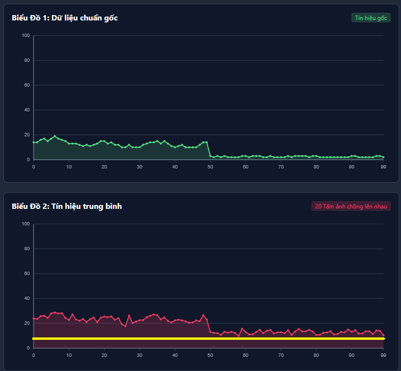

Như vậy, để có được tín hiệu giống như tín hiệu gốc, ta cần trừ đi thêm một giá trị nhiễu trên toàn bộ tấm ảnh. Bạn nghĩ chỉ cần giảm độ sáng của toàn bộ bức ảnh đi là được đúng không? Chưa chắc, vì ta không biết được giảm bao nhiêu là vừa. Nếu giảm ít quá, tín hiệu vẫn chưa sạch, giảm nhiều quá sẽ ăn luôn vào tín hiệu gốc. Cách tốt nhất là xác định rõ giá trị nhiễu trung bình là bao nhiêu rồi trừ đi chính xác.

=== 5.3. Phương pháp chụp ảnh và ảnh hiệu chuẩn

Phần tiếp theo, ta sẽ tìm hiểu cách thức để lấy được tín hiệu nhiễu làm hiệu chuẩn, từ đó giúp xác định được giá trị nào cần được loại trừ. Như ở phần trước, ta biết rằng nhiễu gồm nhiều thành phần có thể đến từ bên ngoài hoặc do chính thiết bị chụp sinh ra. Trong trường hợp này, ta chỉ có thể khử đi nhiễu từ bản thân thiết bị, là Nhiễu dòng tối (Dark Current Noise) và Nhiễu đọc (Read noise). Phương pháp chụp ảnh vật thể ta đã biết ở các phần trên, dưới đây sẽ trình bày cách để chụp lại chỉ riêng tín hiệu nhiễu.

==== 5.3.1. Hiệu chuẩn Nhiễu dòng tối (Dark Frame)

Ảnh chụp vật thể được gọi là Light Frame. Các ảnh chụp nhiễu Dòng tối được gọi là Dark Frame. Chúng được thực hiện bằng cách cài đặt các thông số giống hệt như Light Frame. Nhưng bạn cần che nắp ông kính lại để không cho ánh sáng lọt vào. Ta chụp liên tục nhiều tấm để cho kết quả tốt hơn. Lưu ý rằng ta cần thực hiện trong điều kiện nhiệt độ môi trường bằng với lúc chụp Light Frame bởi vì nhiễu này được sinh ra chủ yếu bới nhiệt độ.

Các ảnh Dark Frame sau đó cũng sẽ được tính trung bình để lấy được giá trị gọi là Master Dark. Ta sẽ trừ đi nó từ ảnh Light Frame.

==== 5.3.2. Hiệu chuẩn Nhiễu đọc (Bias Frame)

Nhiễu này có bản chất là sai số từ các linh kiện khi khuếch đại tín hiệu trên cảm biến. Sai số này bị ảnh hưởng bởi giá trị ISO và không bao gồm nhiệt độ, và không bị tích tụ khi phơi sáng lâu. Do đó, ta cần cài đặt ISO bằng với Light Frame và tốc độ chụp nhỏ nhất để nhiễu dòng tối không sinh ra đủ (1/4000 hoặc 1/8000 tùy dòng máy). Nhiệt độ khi chụp cũng không cần chính xác như lúc chụp Light Frame. Do đó nhiều người thường chụp sẵn và lưu các Bias Frame ở từng mức ISO để tiết kiệm thời gian.

Ta cũng sẽ chụp nhiều tấm như vậy rồi tính trung bình, gọi là Master Bias.

==== 5.3.3. Hiệu chuẩn trường phẳng (Flat Frame)

Ngoài nhiễu ngẫu nhiên, ta còn gặp những trường hợp sai lệch cố định do thiết bị, ví dụ như hiện tượng tối góc do lens không bao phủ hết cảm biến, do bụi dính trên cảm biến làm mờ một vùng nhỏ. Ta có thể chụp thêm các ảnh Flat Frame để thu về những vùng sai lệch này và bù lại ánh sáng lên ảnh kết quả.

Để lấy Flat Frame, hãy nhớ các nguyên tắc sau:

* Giữ nguyên tiêu cự so với Light Frame.
* Giữ nguyên khẩu độ.
* Giữ nguyên vị trí lấy nét (thường là vô cực).
* Giữ nguyên ISO.

Chuẩn bị một nguồn sáng phẳng (màn hình tablet nền trắng, hoặc đèn chuyên dụng), dùng một tấm vải hoặc giấy trắng phủ lên đầu ống kính, đặt nguồn sáng phẳng lên trên. Xem hình dưới:

.Chụp flat frame bằng màn hình tablet nền trắng và vải để tán xạ ánh sáng đều hơn. Ảnh: Trevor Jones - astrobackyard.com
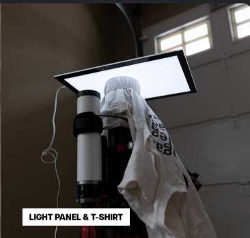

Tiếp theo, ta quan sát histogram trên máy và điều chỉnh tốc độ chụp sao cho vùng đỉnh nằm trong khoảng từ 40-60%. Ưu tiên phơi sáng khoảng 1-3s mỗi tấm (có thể giảm độ sáng màn hình nếu quá sáng). Chụp liên tục nhiều lần.

.Vị trí histogram tối ưu. Ảnh: stargazerslounge.com 
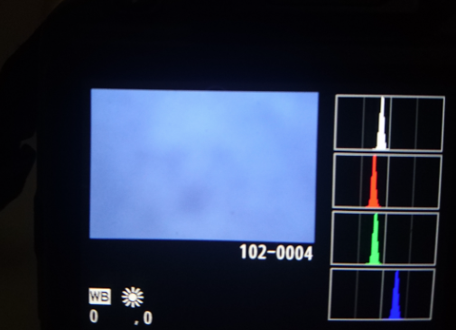

Ngoài ra bạn có thể bổ sung Dark Flat bằng cách giữ nguyên thông số chụp như flat nhưng che ống kính lại. Những ảnh này dùng để khử nhiễu dòng tối cho Flat Frame.

Số lượng Dark, Bias và Flat Frame bao nhiêu là đủ? Thực ra về lý thuyết, khi chụp càng nhiều thì giá trị tính được càng chính xác. Nhưng thực tế, đến một số lượng nhất định, mức độ cải thiện hình ảnh trở nên không quá khác biệt, không còn đáng để đánh đổi thời gian chụp và công sức tính toàn. Do đó cộng đồng khuyến nghị là từ 20-50 tấm mỗi loại là tối ưu.

==== 5.3.4. Thí nghiệm trên mô phỏng

Chương trình mô phỏng dưới đây sẽ giúp bạn hình dung các mà các Dark Frame và Bias Frame giúp khử nhiễu trên ảnh như thế nào. Nó không bao gồm Flat Frame vì sẽ khó hình dung.

++++
<iframe src="signal_processing_sim/signal_sim_w_dark_bias.html" style="width: 100%; height: 100vh; border: none; margin: 0; padding: 0;"></iframe>
++++

Giải thích một chút:

* Khi không sử dụng Dark Frame và Bias Frame, 1 tấm ảnh sẽ bao gồm nhiễu nhiệt và nhiễu đọc, bạn thấy tín hiệu được nâng cao lên một mức nền và có tính bất ổn định.
* Không sử dụng Dark Frame và Bias Frame, nhưng stack nhiều ảnh lại. Ảnh kết quả đã giống hơn với tín hiệu gốc, nhưng được nâng cao lên. Đây chính là mức nền nhiễu mà ta cần loại bỏ bằng Dark Frame.
* Thêm nhiều tấm Dark Frame, bạn sẽ thấy nền nhiễu được loại trừ, ảnh kết quả đã cho tín hiệu gần hơn với giá trị gốc.

Giờ hãy thử thêm Bias Frame, bạn sẽ thấy ảnh không có gì thay đổi. Ơ! Không lẽ lý thuyết ta học từ nãy giờ lại sai à? Thật ra bản thân Dark Frame đã bao gồm cả tín hiệu Nhiễu đọc (do đây là nhiễu mà thiết bị luôn luôn sinh ra). Nên khi trừ đi master dark, nó cũng sẽ trừ luôn cả bias.

Vậy cuối cùng thì Bias để làm gì? Thật ra, Bias Frame được sử dụng để khử nhiễu cho Flat Frame chứ không phải Light Frame. Do Flat Frame có thời gian phơi sáng khác, việc khử nhiễu của nó cần những ảnh hiệu chỉnh riêng. Trong trường hợp này, ta có thể chọn một trong hai Bias Frame hoặc Dark Flat Frame. Dùng Bias Frame khi có thời gian phơi sáng Flat Frame ngắn dưới 1s, giúp quá trình chụp đơn giản. Khi thời gian phơi Flat Frame dài hơn, do Nhiễu dòng tối tích tụ đủ lớn, ta cần phải chụp Dark Flat để khử cả Nhiễu dòng tối và Nhiễu đọc cho nó.

== 6. Tổng kết lại

Ta đã tìm hiểu những vấn đề cần giải quyết của nhiếp ảnh thiên văn, bao gồm ánh sáng yếu, sự tự quay của Trái Đất làm trôi bầu trời, các loại nhiễu có thể xuất hiện khi chụp ảnh.

Ta cũng hiểu được các cách để thu được nhiều ánh sáng hơn khi chụp ảnh:

* Tăng khẩu độ sẽ làm tăng chi phí thiết bị do vấn đề giải quyết quang sai.
* Tăng thời gian phơi sáng cần phải sử dụng các loại chân đế bám nhật động chuyên dụng để tránh làm trôi ảnh.
* Tăng ISO sẽ làm tăng nhiễu, ta cần áp dụng kỹ thuật Stacking để khử nhiễu.

== 7. Thực hành trên Deep Sky Stacker

Từ từ viết sau :D